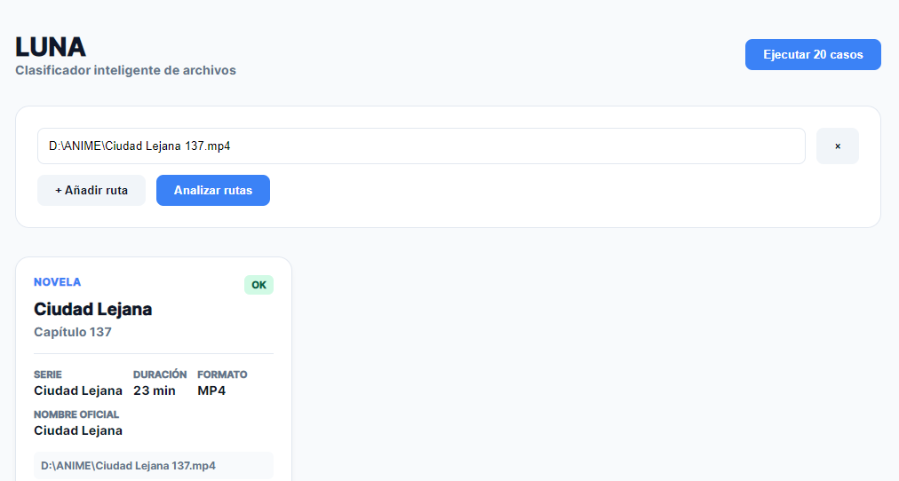
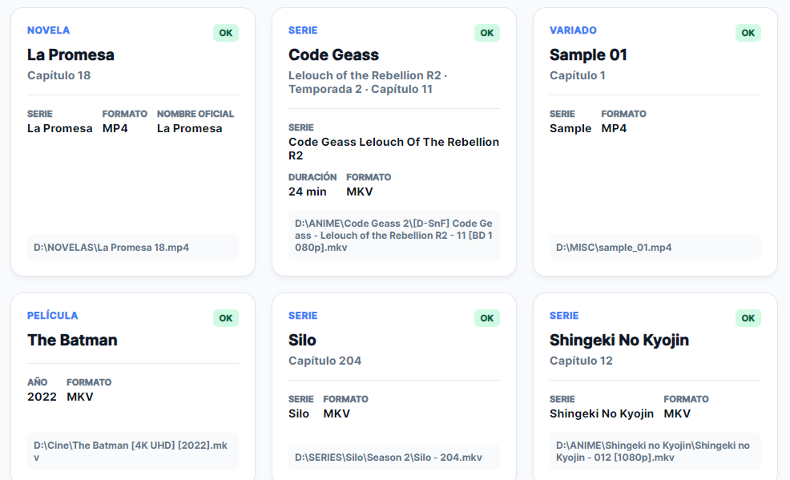
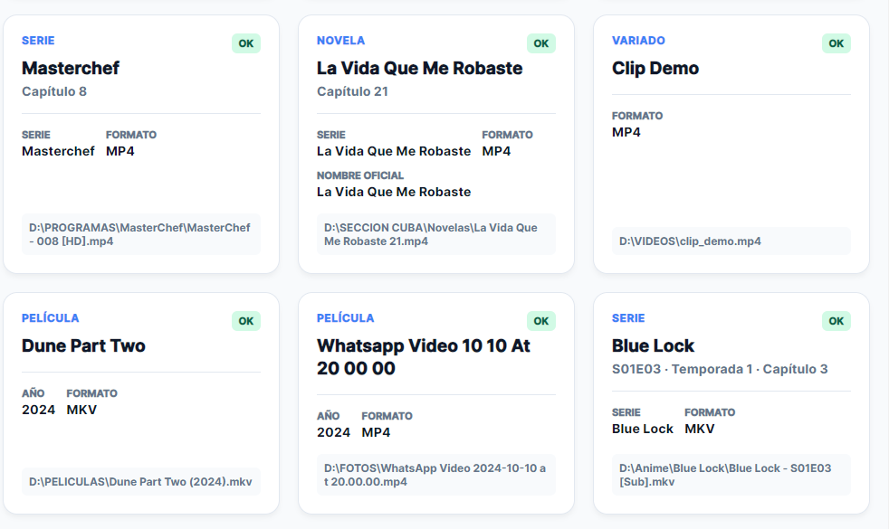

<p align="center">
  
</p>

# 📘 README — Proyecto LUNA

<!-- Banner -->
<p align="center">
  
</p>
> **Clasificador local de archivos multimedia** (película / serie / variado) con sistema de banderas puntuables, rescate por contexto de carpeta y reclasificación mediante base de datos de nombres conocidos.

---

## 📑 Tabla de contenido

1. [¿Qué es LUNA?](#-qué-es-luna)
2. [Filosofía del proyecto](#-filosofía-del-proyecto)
3. [Arquitectura general](#-arquitectura-general)
4. [Estructura de archivos](#-estructura-de-archivos)
5. [Flujo del pipeline](#-flujo-del-pipeline)
6. [Módulos en detalle](#-módulos-en-detalle)
   - [LUNA_clasificador.js](#1-luna_clasificadorjs)
   - [Clasificacion.js](#2-clasificacionjs)
   - [luna_enchufle.js](#3-luna_enchuflejs)
   - [LUNA_Logger.js](#4-luna_loggerjs)
   - [ProcesosCore.js](#5-procesoscorejs)
   - [ResolverPathffmpeg.js](#6-resolverpathffmpegjs)
   - [luna_db.json](#7-luna_dbjson)
   - [probe_LUNA.js](#8-probe_lunajs)
7. [Sistema de banderas](#-sistema-de-banderas)
8. [Sistema de puntajes y decisión](#-sistema-de-puntajes-y-decisión)
9. [Rescate y reclasificación](#-rescate-y-reclasificación)
10. [API pública](#-api-pública)
11. [Ejemplos reales de uso](#-ejemplos-reales-de-uso)
12. [Instalación y dependencias](#-instalación-y-dependencias)
13. [Cómo ejecutar el probe](#-cómo-ejecutar-el-probe)
14. [Novedades v1.2.1](#-novedades-en-v121)
15. [Historial de fixes](#-historial-de-fixes)
16. [Limitaciones conocidas](#-limitaciones-conocidas)
17. [Autoría y licencia](#-autoría-y-licencia)

---

## 🎯 ¿Qué es LUNA?

**LUNA** es un clasificador **local** (sin nube, sin API externa) que recibe una o varias rutas de archivos multimedia y devuelve una etiqueta:

- `esPELI` → película
- `esSERIE` → serie / anime / dorama
- `esPROGRAM` → programa de TV / reality / concurso
- `esNOVELA` → telenovela
- `esVARIADO` → video suelto, clip, personal, documental, deporte

Además devuelve metadata enriquecida: **nombre limpio**, **temporada**, **capítulo**, **año**, **duración**, **fecha extra**, **tipo de archivo** y **puntaje de confianza**.

Fue diseñado para ordenar discos duros llenos de series, películas, novelas y videos personales, respetando nombres "sucios" típicos de la piratería, releases, grabaciones de TV y nombres manuales de series extranjeras.

> Versión actual del proyecto: **1.2.1**
> Base de datos actual: **1.0.0**

---

## 🆕 Novedades en v1.2.1

Esta versión deja el sistema mucho más estable y útil en escenarios reales:

- `infoDBMetadata()` cuenta correctamente el número total de registros de todas las categorías de `luna_db.json`.
- El banner muestra una línea con `DB registros: X`.
- El override de la DB ya se aplica antes del desempate, evitando que series/películas/novelas se queden en una categoría equivocada por heurísticas.
- La comparación normalizada contra la DB corrige nombres con tildes, puntos, espacios y variantes como `Dueñ De Mi`, `La Novia`, etc.
- La salida final expone `extension` y `tipoArchivo` de forma segura (`mkv`, `mp4`, `video`, `audio`).
- Se mantiene compatibilidad con `archivo.info.extension`, `archivo.info.tipoArchivo` y la salida final.
- La lógica de separación de título y nombre limpia siguió refinándose para evitar que capítulos y temporadas se queden pegados en `nombreLimpio`.

---

---

## 🧭 Filosofía del proyecto

| Principio                                   | Descripción                                                                                                 |
| ------------------------------------------- | ------------------------------------------------------------------------------------------------------------ |
| **Banderas puras**                    | Cada bandera recibe un archivo y devuelve `{ puntos, detecciones }`. No decide.                            |
| **Decisión única**                  | Solo `tomarDecision()` compara puntajes y elige la categoría.                                             |
| **Sin regex duplicadas**              | Toda la extracción de info vive en `Clasificacion.js`. `LUNA_clasificador.js` solo orquesta.            |
| **Rescate antes que abandono**        | Si el nombre es solo un número (`33.mp4`), se busca el nombre de la serie en la carpeta padre.            |
| **DB como último recurso**           | `luna_db.json` no suma puntos: solo reclasifica `esSERIE → esPROGRAM / esNOVELA` si el nombre coincide. |
| **No romper con entradas inválidas** | `null`, `{}`, `123`, `[]` deben devolver error controlado, no lanzar excepción.                     |

<p align="center">
  
</p>
---

## 🏗 Arquitectura general

```
┌──────────────────────────────────────────────────────────────────┐
│                        ENTRADA (string | objeto | array)         │
└──────────────────────────────────────────────────────────────────┘
                                │
                                ▼
┌──────────────────────────────────────────────────────────────────┐
│  LUNA_clasificador.js  (orquestador)                             │
│                                                                  │
│  1. normalizarEntrada      →  paquete.rutas[]                    │
│  2. extraerDatos           →  duración, fecha, metadatos         │
│  3. clasificarPorBanderas  →  Clasificacion.clasificarArchivo()  │
│  4. tomarDecision          →  esPELI / esSERIE / esVARIADO       │
│  5. transformarSalida      →  objeto final                       │
│  6. exponerResultado       →  { exito, salida, errores, meta }   │
└──────────────────────────────────────────────────────────────────┘
                                │
                                ▼
┌──────────────────────────────────────────────────────────────────┐
│  Clasificacion.js  (motor de banderas)                           │
│                                                                  │
│  • Banderas sincrónicas de serie    (nombre + ruta + duración)   │
│  • Banderas sincrónicas de película (nombre + ruta + duración)   │
│  • Banderas sincrónicas de variado  (duración + ruta + nombre)   │
│  • Bandera asincrónica compartida   (investigar_carpeta)         │
│  • Bretero (respaldo de contexto por carpeta)                    │
└──────────────────────────────────────────────────────────────────┘
                                │
                                ▼
┌──────────────────────────────────────────────────────────────────┐
│  BD / luna_db.json  (reclasificación final)                      │
│  esSERIE  →  esPROGRAM / esNOVELA                                │
└──────────────────────────────────────────────────────────────────┘
```

---

## 📂 Estructura de archivos

```
proyecto/
│
├── LUNA_clasificador.js       ← Orquestador principal (pipeline)
├── Clasificacion.js           ← Motor de banderas (serie/peli/variado)
├── luna_enchufle.js           ← Singleton lazy del módulo LUNA
│
├── Servicios/
│   ├── ProcesosCore.js        ← Duración con ffmpeg (exec)
│   └── ResolverPathffmpeg.js  ← Localiza ffmpeg/ffprobe/ffplay
│
├── Debug/
│   └── LUNA_Logger.js         ← Log JSON de cada llamada (máx 500)
│
├── BD/
│   └── luna_db.json           ← Nombres conocidos + aliases
│
├── probe_LUNA.js              ← Script de observación / testing
├── package.json
└── README.md
```

---

## 🔄 Flujo del pipeline

```
LUNA(entrada)
   │
   ├─ imprimirBannerLUNA()           (solo la primera vez)
   ├─ crearPaqueteVacio()
   │
   ├─ normalizarEntrada(paquete, entrada)
   │     ├─ string           → rutas = [entrada]
   │     ├─ { ruta, ... }    → rutas = [ruta], opciones
   │     ├─ string[]         → rutas = [...]
   │     ├─ config[]         → rutas = [...], opciones[0]
   │     └─ otro             → error controlado
   │
   ├─ extraerDatos(paquete)
   │     └─ por cada ruta:
   │           ├─ duración real (ffmpeg + timeout 25s)
   │           ├─ fecha de creación
   │           └─ archivo = { nombreOriginal, ruta, duracion, ... }
   │
   ├─ clasificarPorBanderas(paquete)
   │     └─ por cada archivo:
   │           ├─ Clasificacion.clasificarArchivo(archivo)
   │           │     ├─ banderas serie (sync)
   │           │     ├─ banderas pelicula (sync)
   │           │     ├─ banderas variado (sync)
   │           │     ├─ investigar_carpeta (async, compartida)
   │           │     └─ bretero (fallback de contexto)
   │           │
   │           └─ enriquecerArchivoDesdeReporte()
   │                 └─ archivo.info = { nombreLimpio, serie, temporada,
   │                                       capituloNumero, anio, ... }
   │
   ├─ tomarDecision(paquete)
   │     └─ por cada archivo:
   │           ├─ comparar pPeli vs pSerie vs pVari
   │           ├─ si empate → mirar detecciones concretas
   │           ├─ si esSERIE y falta info → rescatarInfoDesdeCarpeta()
   │           └─ si esSERIE → reclasificarDesdeDB()
   │
   ├─ transformarSalida(paquete)
   │     └─ paquete.salida = { nombreOriginal, nombreLimpio, ruta,
   │                            info, duracion, esCC }
   │
   └─ exponerResultado(paquete)
         └─ { exito, salida, errores, meta }
```

---

## 🧩 Módulos en detalle

### 1. `LUNA_clasificador.js`

**Rol:** Orquestador. No contiene regex de clasificación. Toda la lógica pesada está delegada.

**Exports:**

| Export                            | Descripción                                                       |
| --------------------------------- | ------------------------------------------------------------------ |
| `LUNA(entrada)`                 | Función principal. Devuelve `{ exito, salida, errores, meta }`. |
| `normalizarEntrada`             | Convierte la entrada a `paquete.rutas[]`.                        |
| `extraerDatos`                  | Obtiene duración/fecha/metadatos.                                 |
| `clasificarPorBanderas`         | Llama a `Clasificacion.clasificarArchivo`.                       |
| `tomarDecision`                 | Decide `esCC` por puntajes.                                      |
| `rescatarInfoDesdeCarpeta`      | Rescate cuando el nombre es solo un número.                       |
| `transformarSalida`             | Construye el objeto de salida.                                     |
| `exponerResultado`              | Empaqueta respuesta final.                                         |
| `reclasificarDesdeDB`           | Consulta `luna_db.json`.                                         |
| `infoDBMetadata`                | Metadata de la DB (versión, fecha, aliases).                      |
| `LUNAVersion`                   | Info extendida de versión + créditos.                            |
| `cargarDB`                      | Carga lazy de `luna_db.json`.                                    |
| `enriquecerArchivoDesdeReporte` | Deriva `archivo.info` desde el reporte.                          |

**Campos de `archivo.info`:**

```js
{
  nombreLimpio:      string | null,
  serie:             string | null,
  temporada:         number | null,
  capituloNumero:    number | null,
  anio:              number | null,
  esEstructuraSerie: boolean,
  puntajeDeteccion:  number,
  categoriaGanadora: 'serie' | 'pelicula' | 'variado',
  DBmetadata:        { ... }        // solo si reclasificó
}
```

**Banner:** se imprime una sola vez por proceso (flag `seEjecuto`).

**Logger:** cada llamada a `LUNA()` escribe en `%TMP%/luna_debug_log.json` (máx. 500 registros).

---

### 2. `Clasificacion.js`

**Rol:** Motor de banderas. Es la **única fuente de verdad** para extracción de info desde el nombre.

#### Constantes globales

```js
DURACION = {
  PELICULA_MIN: 45*60,  PELICULA_MAX: 4*3600,
  SERIE_MIN:    17*60,  SERIE_MAX:    2*3600,
  VARIADO_MIN:  30,     VARIADO_MAX:  7*60
}

UMBRAL_SALTAR_INVESTIGACION = 80   // si serie ya suma 80, no se investiga carpeta
```

#### Pesos (fragmento)

```js
PESOS_SERIE = {
  sxxexx: 50, nxm: 45, capitulo_texto: 45,
  capitulo_en_corchete: 45, capitulo_programa: 45,
  capitulo_numero_suelto: 30, temporada_en_nombre: 35,
  ruta_novela: 40, ruta_series: 40, ruta_doramas: 40,
  investigar_consecutivo_fuerte: 60, investigar_nombres_serie: 40,
  ...
}

PESOS_PELICULA = {
  anio: 50, secuela_numero: 30, secuela_romano: 30,
  ruta_pelicula: 40, ruta_genero: 25, duracion_tipica_pelicula: 25,
  investigar_un_solo_video: 25, ...
}

PESOS_VARIADO = {
  duracion_corta: 40, ruta_variados: 40, ruta_personal: 35,
  nombre_personal: 40, metadato_camara: 50, ...
}

BRETERO_PESO = 60
```

#### Banderas de serie (sincrónicas)

| Bandera                          | Detecta                                                         |
| -------------------------------- | --------------------------------------------------------------- |
| `serie_sxxexx`                 | `S01E02`, `T2E03`, `[S1][E2]`                             |
| `serie_nxm`                    | `1x09`, `T2xC3`, `T2x03`                                  |
| `serie_capitulo_texto`         | `Cap 4`, `Episodio 12`, `E22` (no si hay SxxExx)          |
| `serie_capitulo_en_corchete`   | `[Cap 4]`, `[Ep 3]`, `[004]` (excluye años/resoluciones) |
| `serie_capitulo_programa`      | `[Programa - 004]`, `[Gala - 002]`                          |
| `serie_capitulo_numero_suelto` | `Serie 033`, `Nombre - 12`                                  |
| `serie_temporada_en_nombre`    | `[T11]`, `Season 2`, `Temp 3`, `S03`                    |
| `serie_ruta_novela`            | carpeta `Novelas/`                                            |
| `serie_ruta_series`            | carpeta `Series/`                                             |
| `serie_ruta_doramas`           | carpeta `Doramas/`                                            |
| `serie_ruta_shows`             | carpeta `Shows/`                                              |
| `serie_ruta_concursos`         | carpeta `Concursos de participación/`                        |
| `serie_ruta_cuba`              | `Sección Cuba` o `Novelas Cubanas`                         |
| `serie_ruta_temporada_carpeta` | carpeta `Temp 2`, `Temporada 3`                             |
| `serie_ruta_pista_debil`       | carpeta `Capítulos/`, `Episodios/`                         |
| `serie_duracion`               | 17 min – 2 h                                                   |
| `serie_idioma_marca`           | `[Dual Audio]`, `[Castellano]`, `[Latino]`                |

#### Banderas de película (sincrónicas)

| Bandera                    | Detecta                                                              |
| -------------------------- | -------------------------------------------------------------------- |
| `peli_anio`              | `(2019)`, `.2019.`, `2019` aislado — NO `[Colombia - 2026]` |
| `peli_secuela_numero`    | `Terrifier 2` (excluye si hay `[Cap-N]`)                         |
| `peli_secuela_romano`    | `John Wick II`, `Rocky IV`                                       |
| `peli_secuela_palabra`   | `Part 2`, `Chapter 3`, `Vol 4`                                 |
| `peli_ruta_pelicula`     | carpeta `Películas/`, `Pelis/`, `Movies/`                     |
| `peli_ruta_pelicula_tag` | `[HD]`, `[Estreno]`, `[4K]`, `[2020-2026]`                   |
| `peli_ruta_genero`       | carpeta `Acción/`, `Terror/`, `Comedia/`                      |
| `peli_duracion`          | 45 min – 4 h                                                        |
| `peli_calidad_tag`       | `[1080p]`, `[4K UHD HDR10]`, `[BluRay]`                        |
| `peli_idioma_marca`      | `[Dual Audio]`, `[Castellano]`, `[Latino]`                     |
| `peli_sin_patron_serie`  | descarte: no tiene patrón de serie                                  |

#### Banderas de variado (sincrónicas)

| Bandera                            | Detecta                                              |
| ---------------------------------- | ---------------------------------------------------- |
| `variado_duracion_corta`         | 30 seg – 7 min                                      |
| `variado_duracion_muy_corta`     | < 30 seg                                             |
| `variado_ruta_variados`          | carpeta `Variados/`, `Random/`, `Misc/`        |
| `variado_ruta_personal`          | carpeta `Personal/`, `Cámara/`, `Celular/`    |
| `variado_ruta_documental`        | carpeta `Documentales/`                            |
| `variado_ruta_animados_variados` | `Animados Variados/`                               |
| `variado_ruta_interesantes`      | `Interesantes/`                                    |
| `variado_ruta_cuba_generica`     | `Sección Cuba` sin `Novelas`                    |
| `variado_nombre_personal`        | `IMG_`, `VID_`, `WhatsApp`, `MVI_`, `DSC_` |
| `variado_nombre_generico`        | `video`, `clip`, `sample`, número suelto      |
| `variado_sin_patron_conocido`    | sin patrón serie ni peli                            |
| `variado_metadato_camara`        | metadato dice cámara/teléfono                      |
| `variado_metadato_personal`      | metadato dice personal/whatsapp                      |

#### Bandera asincrónica compartida

`investigar_carpeta(archivo, contexto)`:

- Lee la carpeta con `fsp.readdir`.
- Cuenta hermanos, consecutivos numéricos, hermanos con patrón serie.
- Suma puntos a **serie** y/o **película** según hechos:
  - `>= 20` consecutivos → `+60` serie
  - `>= 5` consecutivos → `+20` serie
  - `>= 20` hermanos → `+25` serie
  - `>= 5` hermanos con patrón serie → `+40` serie
  - `<= 1` video → `+25` película
  - `2–3` videos → `+15` película
  - 0 consecutivos y `<= 2` numerados → `+15` película
- Si `puntosSerieActual >= UMBRAL_SALTAR_INVESTIGACION` (80), no corre para serie.

#### Bretero (respaldo de contexto)

Recorre la ruta **desde la carpeta más cercana al archivo hacia la raíz**. La primera carpeta que matchee una categoría gana +60 puntos:

```js
BRETERO_CARPETAS = {
  novela:   ['novelas', 'novela', 'telenovelas', ...],
  programa: ['programas', 'shows', 'reality', 'concursos', ...],
  pelicula: ['peliculas', 'pelis', 'movies', 'films', ...],
  serie:    ['series', 'anime', 'doramas', 'kdramas', ...]
}
```

Solo se aplica si **ninguna bandera de ruta `ruta_*` ya sumó**. Se inyecta como bandera `bretero` en `banderasQueSumaron` para debug.

#### Limpiadores exportados

| Función                               | Uso                                                      |
| -------------------------------------- | -------------------------------------------------------- |
| `quitarExtension(nombre)`            | Quita `.mp4`, `.mkv`, etc.                           |
| `normalizarParaMatching(nombre)`     | Fullwidth → ASCII, colapsa espacios, lowercase          |
| `limpiarNombreSerie(texto)`          | Limpieza básica (sin metadata)                          |
| `limpiarNombreSerieAvanzado(nombre)` | Devuelve `{ nombreLimpio, temporada, capitulo, anio }` |
| `limpiarNombrePelicula(nombre)`      | Devuelve `{ nombreLimpio, anio }`                      |
| `nombreDesdeCarpetaPadre(ruta)`      | Última carpeta válida que no sea genérica             |
| `obtenerCarpetasDeRuta(ruta)`        | Array de carpetas                                        |

---

### 3. `luna_enchufle.js`

**Rol:** Singleton perezoso del módulo LUNA.

```js
const { getLUNA, LUNA_PATH } = require('./luna_enchufle');
const LUNA = getLUNA();          // require la primera vez, luego cachea
await LUNA.LUNA('D:\\ANIME\\...');
```

Usado por Cine, convertidor y el IPC del render para no cargar LUNA hasta que realmente se necesite.

---

### 4. `LUNA_Logger.js`

**Rol:** Log JSON rotativo de debug.

- Ruta: `os.tmpdir()/luna_debug_log.json`
- Máx. 500 registros (FIFO).
- Si el JSON está corrupto, se resetea a `[]`.
- Nunca lanza excepción hacia arriba.

<p align="center">
  
</p>

**Estructura de cada registro:**

```js
{
  id:          number,
  fecha:       ISO string,
  versionLUNA: '1.0.0',
  tiempoMs:    number,
  entrada:     any,           // lo que se le pasó a LUNA()
  salida:      object | null,
  errores:     array,
  meta:        { inicio, fin, duracionMs }
}
```

---

### 5. `ProcesosCore.js`

**Rol:** Obtener duración real de un video con `ffmpeg -i`.

**Función principal:** `procesarDuracionMediainfo(rutas)` → acepta string o array.

- Concurrencia limitada a 5 procesos simultáneos.
- Cache `Map` (máx 1000) para no repetir.
- Parseo de `Duration: HH:MM:SS.ms` del stderr de ffmpeg.
- Fallback: si falla el proceso, intenta parsear `error.stderr`.

> ⚠️ Tiene un `setTimeout` de prueba al final que ejecuta un ffmpeg de ejemplo. **Eliminar en producción.**

---

### 6. `ResolverPathffmpeg.js`

**Rol:** Localizar `ffmpeg`, `ffprobe`, `ffplay` en el sistema.

**Orden de búsqueda:**

1. Carpeta indicada por `setBinariosFromFolder(carpeta)`.
2. Sistema (`where ffmpeg` / `which ffmpeg`).
3. `node_modules/ffmpeg-static` y similares.
4. `./ffmpeg-static/ffmpeg.exe` (ruta fija al CWD).

**Exports:**

```js
getFFmpegPath()      // string | throws
getFFprobePath()     // string | null
getFFplayPath()      // string | null
setBinariosFromFolder(carpeta)
resetBinarios()
```

---

### 7. `luna_db.json`

**Rol:** Base de datos de nombres conocidos. **No suma puntos.** Solo se consulta **al final**, cuando `esCC === 'esSERIE'`, para intentar reclasificar a `esPROGRAM` o `esNOVELA`.

**Estructura:**

```json
{
  "version": "1.0.0",
  "fechaActualizacion": "2026-10-19T00:00:00Z",
  "fuente": "curación manual",
  "categorias": {
    "serie":    { "nombres": { "silo": {...}, ... }, "patrones": [] },
    "pelicula": { "nombres": { "superman": {...}, ... }, "patrones": [] },
    "programa": { "nombres": { "masterchef celebrity españa": {...} }, "patrones": [] },
    "novela":   { "nombres": { "ciudad lejana": {...}, ... }, "patrones": [...] },
    "variado":  { "nombres": { ... }, "patrones": [] }
  },
  "aliases": {
    "9-1-1 [temporada 01]": "9-1-1",
    "jobless reincarnation": "mushoku tensei",
    ...
  },
  "correccionesUsuario": [ ... ]
}
```

**Estrategia de match (`buscarEnCategoriaDB`):**

1. Normalizar nombre (quitar acentos, fullwidth, separadores, lowercase).
2. Resolver aliases (máx 3 saltos encadenados).
3. Match exacto.
4. Match por prefijo (solo si la clave de DB tiene ≥ 4 caracteres).

**Categorías consultadas en orden:** `programa` → `novela` (solo si la ganadora fue `serie`).

---

### 8. `probe_LUNA.js`

**Rol:** Script de observación, **no modifica nada**. Sirve para verificar comportamiento.

**Qué hace:**

1. Carga `Clasificacion.js` y `LUNA_clasificador.js`.
2. Verifica existencia de cada ruta en `RUTAS_PRUEBA`.
3. Corre `LUNA.LUNA(ruta)` una por una.
4. Inspecciona el paquete interno del primer archivo (replica `crearPaqueteVacio` local).
5. Imprime tabla resumen al final.
6. (Opcional, comentado) Prueba variantes de entrada y entradas inválidas.

**Uso:**

```bash
node probe_LUNA.js
```

> ⚠️ Espera 3 s antes de ejecutar (setTimeout) para que se estabilicen los binarios.

---

## 🚩 Sistema de banderas

Cada bandera es una función pura (o async si investiga FS):

```js
function bandera(archivo) {
  return {
    puntos: { serie: 50 },          // o { pelicula: N } o { variado: N }
    detecciones: {                  // opcional
      temporada: 2,
      capitulo: 5,
      nombreSerie: 'Silo'
    }
  };
}
```

**Reglas:**

- Si devuelve `{ puntos: {}, detecciones: {} }` → no suma.
- Si `puntos[categoria] === 0` → no entra en `banderasQueSumaron`.
- Las detecciones se fusionan con prioridad a la primera que llegó (no se sobreescriben).

**Ejecución:**

- `ejecutarBanderasSincronas(banderas, archivo, categoria)` → suma y devuelve `{ puntos, detecciones, banderasQueSumaron }`.
- `ejecutarBanderasAsincronasCompartidas(banderas, archivo, contexto)` → suma a serie y peli a la vez.

---

## ⚖️ Sistema de puntajes y decisión

`tomarDecision()` compara:

```js
if (pPeli > pSerie && pPeli > pVari) elegido = 'esPELI';
else if (pSerie > pPeli && pSerie > pVari) elegido = 'esSERIE';
else if (pVari > pPeli && pVari > pSerie) elegido = 'esVARIADO';
```

**Desempate / todo cero — en este orden:**

1. `dSerie.temporada != null || dSerie.capitulo != null || dSerie.nombreSerie` → `esSERIE`.
2. `dPeli.anio != null || dPeli.parte != null` → `esPELI`.
3. `dVari.duracionTipica` → `esVARIADO`.
4. Heurística por duración:
   - `>= 45 min` → `esPELI`
   - `>= 17 min` → `esSERIE`
   - resto → `esVARIADO`

**Después de decidir `esSERIE`:**

1. Si `info.serie === null` → `rescatarInfoDesdeCarpeta()`.
2. `reclasificarDesdeDB()` → puede cambiar a `esPROGRAM` o `esNOVELA`.

---

## 🆘 Rescate y reclasificación

### `rescatarInfoDesdeCarpeta(archivo, esCC, info)`

Se activa **solo si:**

- `esCC === 'esSERIE'`
- `info.serie === null`
- El nombre del archivo es puro número (`33.mp4`) o `Ep N` / `Cap N`.

**Evidencia requerida:**

- **Consecutividad** en la carpeta (`>= 2` hermanos numéricos consecutivos), **o**
- **Video único** (`totalHermanos === 1`) **y** ruta grita serie (`series`, `anime`, `novela`, `programa`, `show`, `temporada`).

**Temporada:** busca en el nombre (`Temp 1`), luego en cada carpeta (`[T2]`, `Temporada 2`), fallback `1`.

Devuelve `info` extendido con `rescatadoDesdeCarpeta: true` y `rescatadoEvidencia: {...}`.

### `reclasificarDesdeDB(archivo, esCC, info)`

Se llama al final de `tomarDecision()` si `esCC === 'esSERIE'`.

- Consulta `luna_db.json` con `info.nombreLimpio`.
- Si matchea `programa` → `esPROGRAM`.
- Si matchea `novela` → `esNOVELA`.
- Añade `info.DBmetadata` con `fuente`, `version`, `categoriaDB`, `nombreOficial`, `viaAlias`, `viaPrefijo`.

---

## 🔌 API pública

### `LUNA(entrada)`

```js
const { LUNA } = require('./LUNA_clasificador');

const r = await LUNA('D:\\ANIME\\Ciudad Lejana 137.mp4');
```

**Entradas aceptadas:**

```js
// 1. string
await LUNA('D:\\ruta\\archivo.mp4');

// 2. objeto config
await LUNA({ ruta: 'D:\\ruta\\archivo.mp4', sin_metadato: true });

// 3. array de strings
await LUNA(['D:\\a.mp4', 'D:\\b.mkv']);

// 4. array de configs
await LUNA([{ ruta: 'D:\\a.mp4' }, { ruta: 'D:\\b.mkv', metadatos: [...] }]);
```

**Salida (por archivo, si fue array):**

```js
{
  nombreOriginal: 'Ciudad Lejana 137.mp4',
  nombreLimpio:   'Ciudad Lejana',
  ruta:           'D:\\ANIME\\Ciudad Lejana 137.mp4',
  info: {
    nombreLimpio:      'Ciudad Lejana',
    serie:             'Ciudad Lejana',
    temporada:         1,
    capituloNumero:    137,
    anio:              null,
    esEstructuraSerie: true,
    puntajeDeteccion:  85,
    categoriaGanadora: 'serie',
    DBmetadata: {
      fuente: 'curación manual',
      version: '1.0.0',
      categoriaDB: 'novela',
      nombreOficial: 'Ciudad Lejana',
      viaAlias: false,
      viaPrefijo: false
    }
  },
  duracion: 2530,
  esCC:     'esNOVELA'
}
```

**Salida global:**

```js
{
  exito:   true,
  salida:  { ... } | [ ... ] | null,
  errores: [],
  meta:    { inicio, fin, duracionMs }
}
```

### `infoDBMetadata()`

```js
const meta = require('./LUNA_clasificador').infoDBMetadata();
// { ok, version, fechaActualizacion, fuente, categorias, totalAliases }
```

### `LUNAVersion()`

Igual que `infoDBMetadata` + `versionLUNA`, `Creador`, `Comentario`.

---

## 🧪 Ejemplos reales de uso

A continuación te dejo ejemplos reales de cómo yo lo uso en proyectos de Node y Electron. Están pensados para que veas exactamente qué entra y qué sale.

### 1) Uso básico en Node.js

```js
const { getLUNA } = require('luna-clasificador');
const LUNA = getLUNA();

(async () => {
  const resultado = await LUNA.LUNA('D:\\ANIME\\La Novia - 107 [15-10-2026].mp4');

  console.log(resultado.exito);
  console.log(resultado.salida.esCC);            // esNOVELA
  console.log(resultado.salida.nombreLimpio);   // La Novia
  console.log(resultado.salida.info.serie);     // La Novia
  console.log(resultado.salida.info.capituloNumero); // 107
  console.log(resultado.salida.extension);       // mp4
  console.log(resultado.salida.tipoArchivo);     // video
})();
```

### 2) Uso con `getFFmpegPath()` y configurando la ruta del binario

Este es un patrón real que uso cuando el proyecto ya tiene ffmpeg en una ubicación custom.

```js
const path = require('path');
const { getLUNA } = require('luna-clasificador');
const { getFFmpegPath } = require('./ResolverPathFFmpeg.js');

const LUNA = getLUNA();
const ffmpegExe = getFFmpegPath();
const carpeta = path.dirname(ffmpegExe) + path.sep;

LUNA.setBinariosFromFolder(carpeta);

(async () => {
  const res = await LUNA.LUNA('D:\\ANIME\\Peliculas\\John Wick 4.mkv');
  console.log(JSON.stringify(res, null, 2));
})();
```

### 3) Uso clásico en una app Node / backend

```js
const { getLUNA, LUNA_PATH } = require('luna-clasificador');
const {
  LUNA,
  reclasificarDesdeDB,
  cargarDB,
  infoDBMetadata
} = getLUNA();

const ffmpegExe = getFFmpegPath();
const carpeta = path.dirname(ffmpegExe) + path.sep;
LUNA.setBinariosFromFolder(carpeta);

(async () => {
  const meta = infoDBMetadata();
  console.log('DB:', meta);

  const salida = await LUNA('D:\\ANIME\\Thunder 3 [Temp 1] [2026] [Caps 12]\\Dueña de Mi - 139 [16-10-2026].mp4');
  console.log(salida.salida.esCC); // esNOVELA
  console.log(salida.salida.info.DBmetadata);
})();
```

### 4) Uso en Electron / proceso principal (`main`)

```js
const path = require('path');
const { ipcMain } = require('electron');
const { getLUNA } = require('luna-clasificador');
const { getFFmpegPath } = require('./ResolverPathFFmpeg.js');

const LUNA = getLUNA();
let lunaInicializado = false;

ipcMain.handle('luna:clasificar', async (event, entrada) => {
  try {
    if (!lunaInicializado) {
      const ffmpegExe = getFFmpegPath();
      const carpeta = path.dirname(ffmpegExe) + path.sep;
      LUNA.setBinariosFromFolder(carpeta);
      lunaInicializado = true;
      await new Promise(resolve => setTimeout(resolve, 500));
    }

    if (entrada === 'info') {
      return await LUNA.LUNAVersion();
    }

    return await LUNA.LUNA(entrada);
  } catch (error) {
    console.error('[LUNA:IPC] Error:', error);
    return {
      exito: false,
      salida: null,
      errores: [{ etapa: 'ipc', mensaje: error.message }]
    };
  }
});
```

### 5) Uso real de ejemplo de mi app con cache de versión

```js
const { getLUNA, LUNA_PATH } = require('luna-clasificador');

const LUNA = getLUNA();

const ffmpegExe = getFFmpegPath();
const carpeta = path.dirname(ffmpegExe) + path.sep;
LUNA.setBinariosFromFolder(carpeta);

let _lunaVersion = null;
function obtenerVersionLUNA() {
  if (_lunaVersion !== null) return _lunaVersion;

  try {
    if (typeof LUNA.LUNAVersion === 'function') {
      const v = LUNA.LUNAVersion();
      _lunaVersion = (v && typeof v === 'object') ? (v.versionLUNA || null) : (typeof v === 'string' ? v : null);
    }

    if (!_lunaVersion) {
      const meta = typeof LUNA.infoDBMetadata === 'function' ? LUNA.infoDBMetadata() : null;
      if (meta && meta.versionLUNA) _lunaVersion = meta.versionLUNA;
    }
  } catch (e) {
    console.warn('[CINE] No se pudo obtener la versión de LUNA:', e.message);
  }

  if (!_lunaVersion) _lunaVersion = 'unknown';
  return _lunaVersion;
}
```

### 6) Qué devuelve LUNA

La salida típica es este formato:

```js
{
  exito: true,
  salida: {
    nombreOriginal: 'La Novia - 107 [15-10-2026].mp4',
    nombreLimpio: 'La Novia',
    tituloLimpio: null,
    fechaExtra: '15-10-2026',
    ruta: 'D:\\ANIME\\Thunder 3 [Temp 1] [2026] [Caps 12]\\La Novia - 107 [15-10-2026].mp4',
    info: {
      nombreLimpio: 'La Novia',
      serie: 'La Novia',
      temporada: 1,
      capituloNumero: 107,
      anio: null,
      extension: 'mp4',
      tipoArchivo: 'video',
      categoriaGanadora: 'serie',
      DBmetadata: {
        categoriaDB: 'novela',
        nombreOficial: 'La Novia'
      }
    },
    extension: 'mp4',
    tipoArchivo: 'video',
    duracion: 1447.26,
    esCC: 'esNOVELA'
  },
  errores: [],
  meta: {
    inicio: 172..., 
    fin: 172..., 
    duracionMs: 120
  }
}
```

> LUNA acepta `string`, `objeto de configuración`, `array de strings` y `array de configuraciones`. Siempre devuelve un objeto con `exito`, `salida` y `errores`.

---

## 📦 Instalación y dependencias

### Requisitos

- **Node.js >= 18** (usa `fs.promises`, `Promise.allSettled`).
- **ffmpeg** accesible:
  - En el PATH del sistema, **o**
  - En `./ffmpeg-static/ffmpeg.exe` (Windows), **o**
  - Configurado vía `setBinariosFromFolder('D:\\ruta\\a\\ffmpeg')`.

### Instalación

```bash
npm install
```

> `package.json` declara `"type": "commonjs"` y `"main": "LUNA_clasificador.js"`.

### Verificar ffmpeg

```bash
ffmpeg -version
```

Si falla, coloca `ffmpeg.exe`, `ffprobe.exe`, `ffplay.exe` en `./ffmpeg-static/`.

---

## 🧪 Cómo ejecutar el probe

```bash
node probe_LUNA.js
```

**Salida esperada:**

```
============================================================
  PROBE LUNA — RONDA 2 — INICIO
============================================================
Node version: v18.x.x
Plataforma: win32
...
PASO 1: cargando módulos
  Clasificacion.js OK
  LUNA_clasificador.js OK
...
PASO 2: verificando existencia de rutas
  OK   [file] D:\ANIME\...
...
PASO 3: LUNA() string simple — una por una
  [1/8] D:\ANIME\...
     tiempo: 125ms
...
============================================================
  RESUMEN TABULAR RONDA 2
============================================================
ARCHIVO                                             | esCC     | duracion   | exito
------------------------------------------------------------------------------------------
Exatlon Mexico [T10] - [TX] [037].mp4               | esPROGRAM| 2530       | true
...
```

**Notas:**

- El probe **no decide nada**, solo observa.
- El paso 4 y 5 (variantes e inválidas) están comentados por defecto.
- Para activarlos, descomenta los bloques correspondientes.

---

## 📝 Historial de fixes

| Código | Archivo                  | Descripción                                                                 |
| ------- | ------------------------ | ---------------------------------------------------------------------------- |
| C1      | `LUNA_clasificador.js` | `extraerInfoDelNombre` ya no duplica regex; delega en `Clasificacion.js` |
| C2      | `Clasificacion.js`     | `peli_anio` ya no captura `[Colombia - 2026]`                            |
| C3      | `Clasificacion.js`     | `serie_capitulo_programa` registrada + peso 45                             |
| C4      | `LUNA_clasificador.js` | `tomarDecision` enriquece `archivo.info` con detecciones                 |
| I1      | `Clasificacion.js`     | `serie_nxm` captura `T2xC3` / `T2xC03`                                 |
| I3      | `Clasificacion.js`     | `serie_temporada_en_nombre` acota T genérica                              |
| I4      | `Clasificacion.js`     | `serie_capitulo_texto` no cuenta `E22` dentro de `S04_E22`             |
| I5      | `Clasificacion.js`     | `peli_sin_patron_serie` ve `[Gala - N]` y `[Programa - N]`             |
| I6      | `Clasificacion.js`     | `normalizarParaMatching` limpia fullwidth / unicode raro                   |
| M1      | `LUNA_clasificador.js` | `nombreLimpio` se calcula según categoría ganadora                       |
| M2      | `Clasificacion.js`     | `serie_capitulo_en_corchete` acepta `[Cap_4]`                            |
| M3      | `Clasificacion.js`     | `serie_temporada_en_nombre` captura `S03` suelto                         |
| M4      | `Clasificacion.js`     | `peli_secuela_numero` no pisa nombres con `[Cap-N]`                      |

---

<p align="center">
  
</p>

## ⚠️ Limitaciones conocidas

1. **`ProcesosCore.js` tiene un `setTimeout` de prueba** que ejecuta ffmpeg sobre un archivo hardcodeado. **Eliminar en producción.**
2. **`LUNA()` imprime banner** la primera vez en cada proceso. Si se importa desde un render, aparece en consola.
3. **Duración con timeout de 25 s**: si ffmpeg se cuelga, el archivo se clasifica con `duracion = 0`.
4. **`luna_db.json` es estático**: se cachea tras la primera lectura. Si se edita en caliente, hay que reiniciar el proceso.
5. **`normalizarClaveDB` no elimina artículos** (`el`, `la`, `los`): un nombre como `El Silo` no matchea `silo`.
6. **La DB solo se consulta para `esSERIE`**. Si una película se clasifica erróneamente como `esPELI` pero está en la DB como `novela`, no se reclasifica.
7. **El `probe` espera 3 s** antes de ejecutar (setTimeout). En CI esto puede ser lento.
8. **`investigar_carpeta` lee el FS sincrónicamente?** No: usa `fsp.readdir` (async). Pero en carpetas de red lentas puede demorar.
9. **Concurrencia de `procesarDuracionMediainfo` limitada a 5**: en discos con muchos archivos, la duración total puede ser alta.
10. **`guardarLogDebug` escribe en `os.tmpdir()`**: en Windows suele ser `%TEMP%`, en Linux `/tmp`. No persiste entre reinicios.

---

## 👤 Autoría y licencia

- **Autor:** Abraham de Jesús Piñirí Megret
- **Agradecimientos:** DeepSeek
- **Licencia:** MIT
- **Versión LUNA:** `1.2.1`
- **Versión DB:** `1.0.0`
- **Fecha DB:** `2026-10-19`

> *"(◕‿◕) Ready to classify ♪♫"*

---

## 📎 Apéndice: glosario rápido

| Término                   | Significado                                                                                      |
| -------------------------- | ------------------------------------------------------------------------------------------------ |
| **Bandera**          | Función pura que suma puntos a una categoría si detecta un patrón.                            |
| **Paquete**          | Objeto interno que acumula rutas, archivos, puntajes, errores, etc.                              |
| **Bretero**          | Respaldo de contexto: si ninguna bandera de ruta sumó, mira la carpeta más cercana al archivo. |
| **Rescate**          | Recuperar nombre de serie desde la carpeta padre cuando el archivo es solo un número.           |
| **Reclasificación** | Cambiar `esSERIE` → `esPROGRAM` / `esNOVELA` consultando `luna_db.json`.                |
| **esCC**             | Etiqueta final: `esPELI`, `esSERIE`, `esPROGRAM`, `esNOVELA`, `esVARIADO`.             |
| **Probe**            | Script de observación que **no modifica** nada.                                           |
| **Enchufle**         | Singleton lazy que carga LUNA solo cuando se necesita.                                           |


## 🆕 Novedades en v1.1.0

Esta versión trae mejoras importantes en cómo LUNA limpia y estructura los nombres de los archivos, separando la información de la obra de la información del capítulo.

> Si estás leyendo esto desde el README actual, ten en cuenta que la versión activa del proyecto es 1.2.1. La sección de v1.1.0 queda como referencia histórica del proyecto, no como versión actual.

### 1. Nuevo campo `tituloLimpio`
Ahora LUNA es capaz de separar el nombre base (serie o película) de su título de capítulo/saga, usando el guion espaciado (` - `) como separador universal.

Si el archivo dice: `Code Geass - Lelouch of the Rebellion R2 - 11.mkv`
*   `nombreLimpio` será: `"Code Geass"`
*   `tituloLimpio` será: `"Lelouch of the Rebellion R2"`

**Regla de seguridad:** Si la parte después del guion es puramente un número (ej. `Ciudad Lejana - 137`), LUNA entiende que no es un título, sino un capítulo, y deja `tituloLimpio` en `null`.

### 2. Limpieza profunda de metadatos
Si LUNA detecta que un número o una temporada (como el `11` o el `R2` del ejemplo anterior) ya fueron identificados como `capituloNumero` o `temporada`, **los elimina automáticamente del `nombreLimpio`**. 
El resultado es un nombre mucho más limpio, sin números de capítulos ni marcas de temporadas pegadas al final.

### 3. Nuevas banderas de detección
*   `serie_capitulo_guion_final`: Detecta capítulos al final del nombre con el formato `" - NN"`, ignorando los corchetes de calidad al final (ej. `[BD 1080p]`).
*   `serie_fansub_tag`: Detecta y acredita la presencia de tags de grupos de fansub al inicio del nombre (ej. `[D-SnF]`, `[SubsPlease]`), ayudando a una mejor limpieza y clasificación.

> **Nota de compatibilidad:** El campo `nombreLimpio` ahora devuelve el nombre con mucha menos "basura" (sin capítulos pegados). Si estabas usando `nombreLimpio` para extraer el número de capítulo, ahora debés usar el campo `info.capituloNumero`.

### Campos de `info` (v1.1.0)

*   `nombreLimpio`: Nombre del archivo sin basura técnica (resoluciones, tags, etc.).
*   `fechaExtra`: **(Nuevo)** Si el nombre original contenía una fecha entre corchetes o paréntesis (ej. `[15-10-2026]` o `[15/10/26]`), se extrae y se guarda en este campo con el formato `DD-MM-AAAA`.
*   `tituloLimpio`: El título del episodio o saga, si estaba separado por un guion (ej. `Chicago PD - [El día...]`).

### Categorización por Base de Datos (v1.1.1)
Si un archivo coincide con la categoría "variado" de `luna_db.json`, LUNA le asigna 350 puntos a la categoría `esVARIADO`. 
Esto garantiza que los dibujos animados o clips catalogados manualmente nunca sean clasificados erróneamente como series o películas por las banderas de heurística.